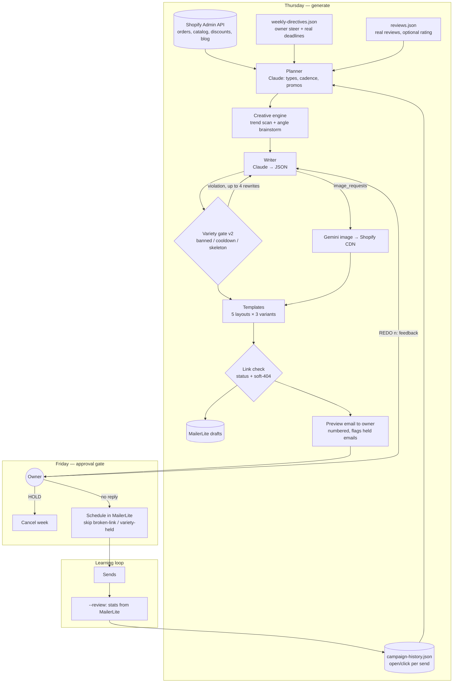

# AI Email Campaign Engine: weekly campaigns from Shopify data, with owner approval by email reply

A scheduled pipeline that plans and writes each week's email campaigns from live Shopify data. It creates the drafts in MailerLite and emails the owner a full preview. Nothing sends until the owner has had a window to reply `HOLD` or `REDO`. After each send, open and click stats go back into the planner, so later weeks build on what worked.

## The problem

A multi-channel e-commerce business sold to retail customers, domestic wholesale buyers and international distributors. Each audience needed its own weekly email, and nobody had time to write three. Earlier attempts at automating this produced two problems:

- **Sameness.** The model wrote close to the same email every week: same hero product, same subject structure, a new number swapped in.
- **Trust.** Fully automatic sending meant the owner first saw an email after customers did.

The business needed campaigns that were data-driven and actually varied week to week, while keeping a human in control of every send.

## What it does

One Node.js script (`src/campaign-generator.js`) runs in four modes on a GitHub Actions schedule:

| When (ET) | Mode | What happens |
|---|---|---|
| Thu 10 PM | `--generate` | Pulls 90 days of Shopify orders, catalog, new arrivals, blog posts and active discounts. Claude plans the week, choosing 1–3 emails per segment, a campaign type for each, the send days and whether to run a promo. A creative step brainstorms angles. Claude writes each email as structured JSON, and a template renders it to HTML. The pipeline generates one AI image (Gemini) and hosts it on the Shopify CDN, link-checks the email, creates a MailerLite draft per email and sends the owner one numbered preview. |
| Fri 5 PM | `--schedule` | Reads the owner's replies over IMAP. `HOLD` cancels the whole week. `REDO 2: more product-led, fewer words` regenerates email #2 with that feedback and sends a fresh preview. That pass then skips scheduling so the owner can review the new version. If there is no reply, the drafts are scheduled for the following Mon–Sun. |
| Fri 8 PM | `--schedule` | Catch-up pass that schedules drafts updated by a redo. |
| Thu 7 PM | `--review` | Pulls sent/open/click/unsubscribe counts from MailerLite into `state/campaign-history.json` and emails the owner a digest. The next planner and writer prompts include this history: best and worst performers, results by campaign type, recent subjects to avoid. |

Other modes: `--redo 2,4 --feedback "..."` (manual redo), `--check-feedback`, `--cleanup-sales` (reverts expired sale prices).

## Architecture



## Key design decisions

**Human in the loop by default, not by exception.** Generation and sending are separate runs about 19 hours apart. Drafts exist in MailerLite before the owner sees the preview, so a reply only cancels or swaps drafts and never has to stop a send that is already in flight. The reply parser:
- strips quoted text and `>` lines, so the instruction examples printed in the preview can't be mistaken for real commands;
- resolves on the IMAP fetch `end` event, not the message `end`. That race once returned empty bodies and let campaigns go out past a valid REDO;
- stores `feedbackProcessedAt`, so a later scheduler pass doesn't apply the same reply twice. IMAP `SINCE` filters by day only.

**Hard gates that block scheduling.** Two flags stop the scheduler, and the preview shows both:
- `brokenLinks`: every href gets a HEAD or GET request. Store links get a full GET, which catches soft-404s (a redirect to the homepage or a "page not found" title).
- `varietyBlocked`: the email is still repetitive after four rewrites.

Blocked emails stay in state, so a REDO plus the catch-up pass can still ship them.

**Variety enforced in code, not just in the prompt.** A prompt rule like "don't repeat yourself" proved unenforceable on its own. `src/creative-engine.js` adds:
- persistent editorial rules (`config/editorial-rules.json`): banned heroes and banned subject regexes, so owner feedback lasts beyond one week;
- a 28-day cross-segment hero cooldown and same-week hero dedup;
- subject similarity checked on number-collapsed skeletons, so "120 reviews. 4.8 stars." matches "135 reviews. 4.7 stars.";
- layout-variant rotation (A/B/C);
- a type-rotation pool per segment that excludes that segment's last two campaign types;
- a 30-day cooldown on news-angle emails.

**Owner steer without micromanagement.** `config/weekly-directives.json` (`week_of` must match the target Monday or the file is ignored) tells the planner *what* each segment should feature, or `skip`. The model still decides layout, cadence and copy. Steered topics are exempt from the repetition checks but not from banned-product rules.

**Idempotent, collision-safe runs.**
- A cron `--generate` that fires within 20 hours of an existing generate is skipped. GitHub crons can fire hours late and had once overwritten reviewed redos.
- Redo never deletes a campaign that has already been sent, because MailerLite deletes its stats along with it. A scheduled campaign is cancelled back to draft before it is replaced.
- Send dates anchor to the *target* week, not to "next Tuesday from today".
- Promo end dates anchor to the target Monday, so a promo can't expire before the week's sends.

**Graceful degradation.** If the trend scan, the angle brainstorm or image generation fails, the run continues without that piece. If image upload fails, the email sends without the image. The workflow retries the state push three times and fails loudly, because the Friday run depends on that state.

### Design rules: no fabricated social proof, urgency only from real deadlines

Both rules are enforced in code, at four layers: planner pool, writer prompt, output sanitizing and template router.

- **No fabricated social proof.** The model never writes testimonials. `social_proof` can only be planned when `config/reviews.json` holds at least two real reviews exported verbatim from the store's review platform. Code attaches those reviews to the email, with author label, source and date. The writer's output is stripped of any `testimonials` or quote fields. If no reviews are attached, the template router falls back to a non-review layout. An aggregate star rating appears only when the owner supplies one (from `reviews.json` or the `REVIEW_RATING` and `REVIEW_COUNT` env vars). Nothing is scraped, and there is no hardcoded fallback value. With no rating configured, no rating strip renders.
- **Urgency only from real deadlines.** `urgency_scarcity` is only offered for a segment that has a real end date that week. Two sources count: a `deadlines` entry in the owner's weekly directives, or an active Shopify discount with an `ends_at`. The writer is given that exact date and told not to invent any other deadline, stock count or scarcity claim. With no deadline, `countdown_text` is removed in code and the urgency layout isn't used.

`npm run sample` renders every layout offline and asserts both rules: injected fake quotes and countdowns must not appear in the HTML.

## Repository layout

```
src/campaign-generator.js   planner, writer, MailerLite, approval gate, review loop (all modes)
src/creative-engine.js      editorial rules, hero cooldown, variety gate v2, trend scan, angle brainstorm
src/email-templates.js      5 HTML layouts x 3 variants, rating strip, real-review cards, router
src/email-images.js         Gemini image generation + Shopify Files CDN upload
src/config.js               all store-specific settings from env
config/                     editorial rules, example directives, example reviews file
scripts/render-samples.js   offline render + honesty assertions
.github/workflows/          the four-cron schedule
```

## Setup

Requires Node 20+, a Shopify custom app (read orders; read and write products, price rules/discounts and files), a MailerLite account with one group per segment, an Anthropic API key, an optional Gemini API key, and a mailbox with IMAP/SMTP access and an app password.

```bash
npm install
cp .env.example .env                                     # fill in values
cp config/weekly-directives.example.json config/weekly-directives.json   # optional
cp config/reviews.example.json config/reviews.json       # optional — real reviews only
npm run sample                                           # offline check, no API calls
npm run generate                                         # creates real MailerLite drafts + preview email
```

| Variable | Purpose |
|---|---|
| `STORE_NAME`, `STORE_URL`, `RETAIL_PATH`, `WHOLESALE_PATH`, `LOGO_URL`, `PROMO_PREFIX` | Store identity used in prompts, links and templates |
| `SHOPIFY_STORE`, `SHOPIFY_ADMIN_TOKEN` | Shopify Admin API |
| `SHOPIFY_BLOG_ID`, `SHOPIFY_BLOG_HANDLE` | Optional blog cross-promotion |
| `MAILERLITE_API_KEY`, `MAILERLITE_RETAIL_GROUP_ID`, `MAILERLITE_WHOLESALE_GROUP_ID`, `MAILERLITE_INTERNATIONAL_GROUP_ID` | Drafts, scheduling, stats; international group is auto-discovered by name if blank |
| `FROM_NAME`, `FROM_EMAIL` | Campaign sender |
| `ANTHROPIC_API_KEY`, `ANTHROPIC_MODEL` | Planner, creative engine, writer |
| `GEMINI_API_KEY`, `GEMINI_IMAGE_MODEL` | Optional campaign imagery |
| `OWNER_EMAIL`, `MAIL_USER`, `MAIL_APP_PASSWORD`, `SMTP_HOST`, `SMTP_PORT`, `IMAP_HOST` | Preview emails and HOLD/REDO replies |
| `REVIEW_RATING`, `REVIEW_COUNT`, `REVIEW_SOURCE`, `REVIEW_PROFILE_URL` | Optional aggregate rating if `reviews.json` has none |
| `NEWS_QUERIES` | Comma-separated news queries for the rare news-angle email |
| `EXPORT_ELIGIBLE_PATTERN`, `INTERNATIONAL_HERO_PATTERN` | Regexes selecting which products the international segment may feature, and which lead |
| `LINK_CHECK_SKIP` | Regex of hosts the link checker should skip |
| `CONFIG_DIR`, `STATE_DIR` | Override `config/` and `state/` locations |

In GitHub Actions, put the keys and passwords in repository **secrets**. The identity, host and optional behaviour values (`STORE_NAME`, `STORE_URL`, `OWNER_EMAIL`, `FROM_NAME`, `FROM_EMAIL`, `SMTP_HOST`, `SMTP_PORT`, `IMAP_HOST`, plus any of the optional settings above) go in repository **variables**. `ANTHROPIC_MODEL` and `GEMINI_IMAGE_MODEL` use their code defaults in CI unless you add them to the workflow. The workflow carries `state/` between runs in the Actions cache, so campaign history is never committed to the repository.

## Results

From the production history file, July 2 to October 16, 2026. Aggregate figures only:

- **113** campaign drafts generated, counting redos and held drafts. **41** were sent and reviewed.
- Across all sends, weighted by recipients: **21.0%** open rate, **2.43%** click rate, **0.33%** unsubscribe rate.
- By segment: international distributors **33.7%** open / **3.85%** click (14 sends), domestic wholesale **22.5%** / **2.34%** (9), retail **20.1%** / **2.39%** (18).
- The weakest campaign type was `social_proof`, at **10.1%** open over 2 sends. That is part of why the type is now gated behind real reviews and is no longer a default option.

Open rates are inflated by privacy-protected mail clients and should be read as relative, not absolute. These figures come from before the honesty rules above were added to the code.

---

Extracted from a production automation suite I built and ran for a live e-commerce business, 2026.

© Michael Wootan. Source shared for portfolio review; all rights reserved.
